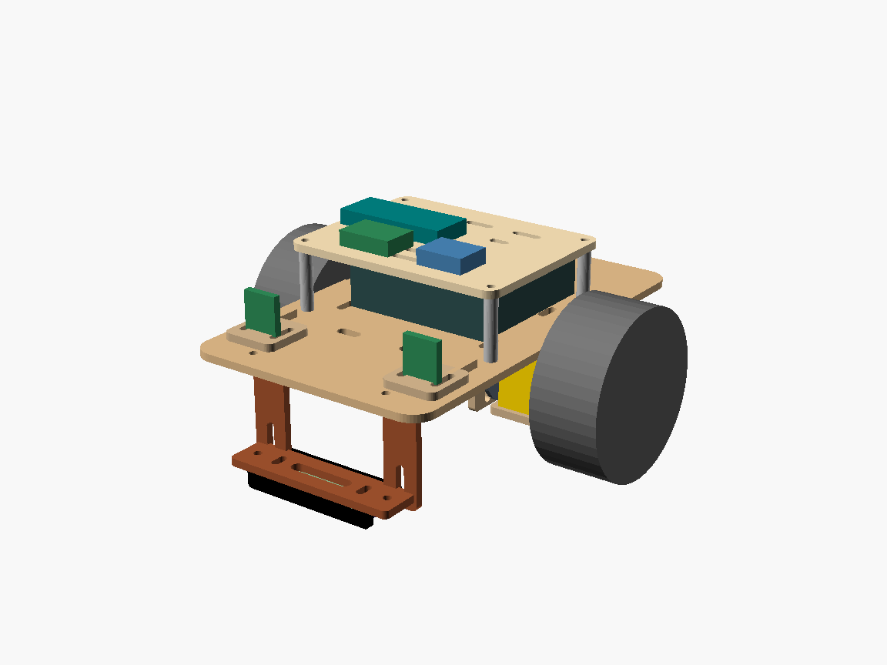

# 车架加工与装配

[尺寸与安装基准图](尺寸与安装基准.svg) · [参数化源文件](chassis.scad) · [激光切割](激光DXF/) · [打印模型](打印STL/)

整车参考包络为 \(164\times157\times84\,\mathrm{mm}\)，含轮胎和板件，电子器件为预估占位。线束、螺钉、插头装好后复量，审阅目标为 \(170\times160\times90\,\mathrm{mm}\)。原点在底板平面中心，前方为正纵向，地面为零高度。轮距 \(130\,\mathrm{mm}\)，轮径 \(65\,\mathrm{mm}\)，轮轴位于纵向 \(-12\,\mathrm{mm}\)。底板下表面目标高 \(48\,\mathrm{mm}\)；前探头比车鼻后退 \(10\,\mathrm{mm}\)。装配图中的颜色用来区分板件和外购件。

| 文件名 | 每车数量 | 作用及安装 |
|---|---:|---|
| base | 一 | 底板，约 \(100\times164\,\mathrm{mm}\)。木板切割为平面，打印版上方有两条短筋。 |
| tray | 二 | 电机下夹片，长边沿行进方向。每侧两根扎带穿底板内槽、外侧开口和夹片凹口，夹紧齿箱及电机外壳，避开轴和齿轮。 |
| encoder | 二 | 用一枚直角片把吊板竖装在底板下，与码盘平行。吊板上部长孔调高度，底板横槽调横向位置；光耦板扎在吊板中部两槽。让内轴码盘边缘进入叉口，光束对准槽环，手转计数后锁紧。 |
| deck | 一 | 上层电控板，用四根约 \(24\,\mathrm{mm}\) 隔柱。Nano 水平固定，USB 口朝侧面，电池低放夹在两层之间并绑在底板。 |
| drop、probe | 二、一 | 两片垂直吊片和一块水平探头托盘。底板与吊片、吊片与托盘各用一对 M3 直角片。吊片下部长孔调高。探头面先调至距地 \(2.5\) 至 \(4\,\mathrm{mm}\)，左右等高。 |
| hood | 二 | 探头前后各一片黑色遮光板，用小扎带穿孔连到反射板短边支点，必要时垫片调高。朝下的发射与接收窗口开敞，遮光板下沿不得接触广告布。 |
| tof | 二 | 各由底板的一枚带垫片螺钉固定为可转支架。各加一枚直角片竖装测距板，小扎带穿两槽绑紧。光轴朝前，先平行安装，校准后锁紧。 |
| caster | 一 | 后滚珠转接板；内侧两孔通过隔柱固定到底板，外侧两槽匹配约 \(38\) 至 \(40\,\mathrm{mm}\) 安装孔距。选小号钢球约 \(15.8\,\mathrm{mm}\)、轮高约 \(19\,\mathrm{mm}\) 的款式。 |
| coupon | 一件试片 | 底板右电机区域的实际轮廓，配一件 tray 和一件 encoder，先试轮胎、齿箱和内侧码盘。试片不装入整车。 |

**先量后加工。** 拿到电机、码盘、槽型模块、后滚珠、电池盒和测距板，在图纸记录实测尺寸。重点量轴到电机安装面的高度、轮毂插入深度、内侧码盘直径及轴向位置、光耦槽底位置、后轮孔距和厚度、带插头电池盒的外廓。若电机端面高度不同，用垫片调到车轮着地、底板水平并复测探头高度。车尾支撑高度由底板下表面减转接板厚及后轮实测总高得到，标称隔柱组合约 \(26\,\mathrm{mm}\)。电池盒选单层横排，建议外廓至多 \(61\times62\times21\,\mathrm{mm}\)，放在纵向 \(-13\,\mathrm{mm}\) 附近，由束带防滑固定。用秤分别称左右轮及后滚珠的静载，三处均保持正压力；若后轮卸载，将电池向车尾移动。

**激光工艺。** 在中心教师确认材料后用 \(3\,\mathrm{mm}\) 胶合板。导入 DXF 选毫米、原比例，以底板长度 \(164\,\mathrm{mm}\) 复核。零件逐件排版，优先做试片；试切圆孔检查 M3 通孔、板厚和切缝，仅在 CAM 或设计其中一个位置补偿。切割先内孔后外轮廓；去毛刺，磨平所有可能刮广告布的边。

**打印工艺。** STL 平放，底板筋面朝上。初始使用 PLA、\(0.2\,\mathrm{mm}\) 层高、三道外壁、\(25\%\) 填充；以中心设备和材料参数为准。先打印试片、夹片和测速座，试装后再打印底板和其余部件。有效平台至少覆盖底板；若平台较小，可改用中心激光设备或在源文件中重新设计有连接强度的分件后复验。

**装配顺序。** 电机和码盘 → 后滚珠及底板调平 → 电池和承重检查 → 探头托盘、遮光片与测距支架 → 电控层与线束。两侧各手转十圈，确认轮胎、码盘、叉口和螺钉均无干涉，再安装电池。最后检查 USB 插头、按键可达、束线不超出包络，拍摄带尺子的三个方向照片。安装暂定尺寸以实测为准。

**重出文件。** OpenSCAD 2021.01 打开源文件，选 part 和输出模式；用 PowerShell 7 执行同目录的 export.ps1 并用 OpenSCAD 参数指定 openscad.com 的路径，可以一次重出 DXF、STL 和预览。底板开槽和轮径参数变化时同步更新固件 Settings.h 及尺寸基准图。
