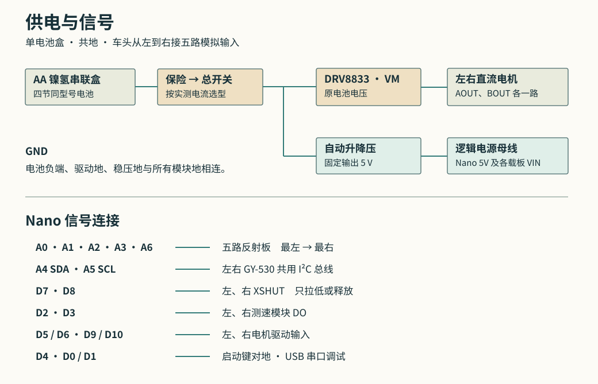

# Nano 接线与首次上电

按驾驶方向区分左右，从车顶看车头朝前。主控为经典 Nano V3／ATmega328P。所有地线相通，马达回流直接返回驱动板和电池负端，避免经过传感器地线。下图实线为供电，信号按下表接。充电器在车外使用。

| Nano／端子 | 去向 | 接法 |
|---|---|---|
| A0、A1、A2、A3、A6 | 五个反射探头 | 依次为最左、左中、中、右中、最右，直接读模拟电压。A6 只用作模拟输入。 |
| A4、A5 | 两块 GY-530 的 SDA、SCL 并联 | 选能接 \(5\,\mathrm V\) 逻辑的载板，核对原理图上 SDA/SCL 双向电平转换；只标 VIN 支持宽压不足以确认。检查并联上拉后的阻值。 |
| D7、D8 | 左、右 XSHUT | 启动时同时拉低，逐块切为高阻输入，由模块低压侧上拉，每次冷启动分别分配地址 0x30、0x31。严禁直接上拉至 Nano 的 \(5\,\mathrm V\)。 |
| D2、D3 | 左、右槽型测速模块 DO | 比较器输出，应能给 Nano 稳定高低电平。每个二十槽码盘转一圈应读到约 \(40\) 个边沿。模块的电源和地另接。 |
| D5、D6 | DRV8833 AIN1、AIN2 | AOUT1/AOUT2 接左马达。 |
| D9、D10 | DRV8833 BIN1、BIN2 | BOUT1/BOUT2 接右马达。正向输出须让各轮均推车向前，镜像安装的一侧可能需要对调马达两线。 |
| D4 | 常开启动键 | 另一端接公共地，代码开内部上拉。D13 板载灯显示就绪／运行／停车。 |
| D0、D1 | USB 串口 | 留给调试。USB 测试先切断电池；带载跑车前拔下 USB。 |
| 电池正 → 保险 → 总开关 | 分为 VM、电源转换器 VIN 两支 | 同盒四节同型号 AA 镍氢，标称 \(4.8\,\mathrm V\)。驱动板 VM 取开关后电压。电池盒导线、开关和保险须覆盖正常双轮启动电流；按电机资料、电流实测及导线额定选保险。 |
| 升降压 VOUT | Nano 5V、反射阵列、两路测速、两块测距板 VIN | 输出固定 \(5.0\,\mathrm V\)，建议逻辑支路连续能力至少 \(0.3\,\mathrm A\)。确认兼容板外接稳压输入，勿接 VIN。先空载量电压，再插板。 |
| 驱动器 nSLEEP | 依载板原理图 | 选已上拉启用的板；引出但无上拉时按载板允许电平使能。使用共地、带 PWM 输入下拉的版本，复位时输出关闭。 |

**反射板。** 用 \(2.54\,\mathrm{mm}\) 洞洞板，五路各占四个孔距，中心间距 \(10.16\,\mathrm{mm}\)。每路从稳压正端经独立 \(220\,\Omega\) 电阻接红外 LED 阳极，阴极接地；光敏三极管发射极接地，集电极经独立 \(10\,\mathrm{k\Omega}\) 上拉至稳压正端，在集电极取模拟输出。按厂家图确认 LED、集电极和发射极方向。板边设置电源、地、五路信号七线连接，传感器面朝地，投光区与收光区都要露出。反射板旁放 \(100\,\mathrm{nF}\) 去耦。传感器典型峰值距离 \(2.5\,\mathrm{mm}\)。[器件引脚与光学曲线](https://www.vishay.com/docs/83760/tcrt5000.pdf)

**抗干扰与电流。** 每个马达端子间就近并 \(100\,\mathrm{nF}\) 陶瓷电容。VM 与地就近并 \(100\) 至 \(470\,\mathrm{\mu F}\) 电解电容及 \(100\,\mathrm{nF}\) 陶瓷电容。采购时核对驱动板封装、每通道连续能力与电机在实际电压下的堵转电流；芯片同名的不同封装有不同额定值。使用中心限流电源检验起步与短时制动，电池盒、驱动及线束不能发热，主控不能复位。不要靠长时间锁死车轮测堵转。[TI 驱动规格](https://www.ti.com/lit/ds/symlink/drv8833.pdf) · [测距载板电平说明](https://www.pololu.com/product/2490)

**通电顺序。** 先断电查正负短路和马达回路，再只接电池与转换器测输出，接逻辑板后核对五路反射、两路距离、左右计数，最后架空车轮接驱动。用同一充电器给整组同型号电池充电；比赛时车上只有电池盒一路输入。遇到距离持续无效、黑白对比太小或单轮没有脉冲，先对照固件调试表。
